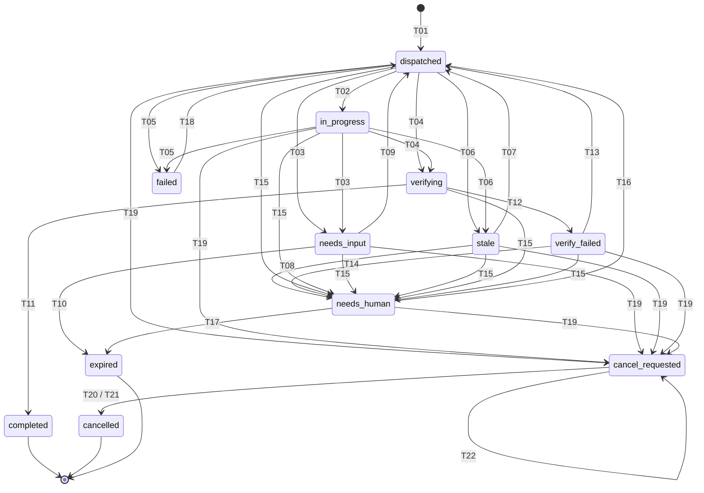

한국어

# grok-cue 비정상 상황 처리 분석·설계안 (v5, 검토 의견 8개 반영)

- 대상: `bluecafe/grok-cue` main `2483c3b` (0.0.1). 읽기 전용으로 `app/forward.py`, `app/main.py`, `app/auth.py`, `app/store.py`를 다시 읽어 확인했습니다.
- 범위: 문서만. 코드·테스트·Bridge 수신기·메일 루틴·인프라·시크릿·배포는 건드리지 않습니다.
- 표기 (모든 문장·행에 셋 중 하나):
  - **[현행 구현]** 코드에서 확인한 동작. 파일·함수를 함께 적음
  - **[제안·미구현]** 설계 제안. 코드도 테스트도 없음. "~합니다"로 써도 구현됐다는 뜻이 아님
  - **[미검증 전제]** 아직 아무도 확인하지 않은 가정
  - 노른(사용자)이 확정한 원칙은 **[결정]**을 덧붙입니다. 결정이어도 구현은 별개입니다.
- 공개 도메인은 `hook.bluecafe.kr`만 씁니다. 비밀값·실명은 넣지 않습니다.

## 1. 검증 상태와 Cue의 현실적인 경계

### 1.1 2026-10-29 단건 시험 [현행 구현 + 사람 확인]
| 항목 | 상태 | 근거 |
|---|---|---|
| Cue가 새 작업 메일을 받아 명세와 GitHub 참조를 확인 | 단건 확인 | 노른(사용자) 확인 |
| Cue 서명 POST → `HTTP 202`, `status: received`, `executed: false`, `forwarded: true` | 단건 확인 | 노른(사용자) 확인 |
| 노른(사용자)이 16:05 KST에 Grok 쪽 수신 확인 | 단건 확인 | 노른(사용자) 확인 |

이 시험은 **그 실행환경에서 단건 전송·전달이 한 번 통했다**는 것만 입증합니다. 다음은 입증하지 않습니다 [미검증 전제]:
- 모든 Cue 채팅 작업이 자동으로 푸시된다는 것
- 재시도·재서명·장애 복구가 동작한다는 것
- 다른 환경·다른 시점에도 같은 결과가 나온다는 것

### 1.2 세 가지 신호를 구분합니다
| 신호 | 뜻 | 근거 |
|---|---|---|
| `202` | **Bridge가 접수했다.** 현재는 메모리 저장뿐이라 재시작하면 잊음 | [현행 구현] `main.py: create_task`, `store.py: IdempotencyStore`("Restarting the process forgets prior acceptances") |
| `forwarded: true` | **Bridge의 전달 주장.** 현재는 "이 요청에서 전달을 예약했다"는 뜻. Grok 2xx 확인이 아님 | [현행 구현] `main.py`: `background_tasks.add_task(...)` 직후 `scheduled = True`, 응답 `forwarded = scheduled`. 실패는 `forward.py: GrokForwarder.send`가 로그만 남김 |
| Grok 실제 수신 | Grok의 회신이나 사람의 별도 확인으로만 압니다 | 10-29 시험은 노른(사용자) 확인 |

참고 [현행 구현]: 같은 키·같은 바디 재전송의 응답은 `forwarded: false`입니다(`main.py`, `result.created`가 false면 `scheduled=False`).

### 1.3 Cue가 할 수 있는 일 [미검증 전제, 10-29 단건만 확인]
Cue는 새 작업 메일을 받으면 ① 명세와 GitHub 참조를 확인하고 ② 맡은 일을 마친 뒤 ③ 서명 POST를 **단건** 보낼 수 있습니다. 자동 감시·heartbeat·주기 보고는 없습니다 [결정]. 재시도·취소 확인 등 그 밖의 Cue 동작은 모두 [미검증 전제]입니다.

## 2. 역할·권한 경계 [결정]
| 주체 | 하는 일 | 하지 않는 일 |
|---|---|---|
| Grok 측 | handoff 메일 작성, `handoff_id` 발급, GitHub 참조와 명세 전달 | Cue 산출물 대신 작성 |
| Cue | 메일 확인 → 참조 확인(4절) → 불일치면 추측 없이 `needs_input` → 명시된 저장소·브랜치·경로 안에서만 작업 → 서명 POST 1건 | Grok 코드, 메일 루틴, Bridge 수신기, 시크릿, 인프라 수정 |
| Bridge | 서명 검증, 접수, 8필드 전달 [현행 구현]. 상태 기록 [제안·미구현] | 작업 실행, 메일 발송, 머지·배포·결제 |
| 노른(사용자) | 승인, 재개·종료, 키 교체 | — |

인계·`202`·`forwarded`·`completed`는 머지·배포·결제 승인이 아닙니다 [결정]. 응답은 항상 `executed: false`입니다 [현행 구현] (`main.py`, `test_successful_forward_is_scheduled_and_not_execution`).

### 2.1 GitHub 계정·권한 현실 [노른(사용자) 확인 사실 + 위험]
- 노른(사용자) 확인(2026-10-30): Cue는 지금 **저장소 소유자와 같은 GitHub 계정**을 씁니다. 따라서 Cue는 소유자 권한(설정 변경, PR 생성·머지 등)을 가집니다. main 직접 push는 아래 보호로 거절됩니다 [현행].
- **위험**: 2절의 역할 경계는 문서 약속으로만 지켜지고, 기술적으로 전부 강제되지는 않습니다. main 직접 push·force push·브랜치 삭제는 아래 보호가 막습니다 [현행]. 같은 계정이므로 PR을 만들고 머지하는 것은 기술적으로 가능하고, 그 제한은 문서에 적힌 규칙으로만 통제됩니다.
- 공개 저장소 권한 참고:
  - 누구나 읽기, Issue 열기, fork 후 PR을 만들 수 있습니다. 외부 PR은 쓰기 권한이 없으면 머지할 수 없습니다.
  - Triage 역할: Issue·PR 라벨·닫기 등 관리만, 코드 push 불가. Write 역할: 브랜치 push와 (보호 규칙이 없으면) main push·머지 가능.
  - main 브랜치 보호 [현행]: 이미 적용되어 있습니다. `enforce_admins=true`, PR 필수, 승인 0개 필수, force push 금지, 삭제 금지. Actions가 꺼져 있으므로 필수 status check는 없습니다. 2026-10-30 17:27 KST에 `gh api`로 확인했습니다. 앱 코드의 [현행 구현]이 아니라 GitHub 저장소 설정입니다.
- 별도 계정·토큰은 [제안·미구현]입니다. 그 설정이 되어 있다고 확인된 것은 없으며, GitHub에서 확인하기 전까지 [미검증 전제]로 봅니다.

## 3. 현행 정상 사이클 [현행 구현]
| 단계 | 내용 | 위치 |
|---|---|---|
| S1 | Grok → Cue 작업 메일 | Bridge 밖 |
| S2 | Cue 확인·작업 | Bridge 밖 |
| S3 | `POST https://hook.bluecafe.kr/v1/cue/tasks` | `main.py: create_task` |
| S3a | 인증 전 64 KiB 제한 | `MAX_BODY_BYTES`, `read_limited_body` |
| S3b | 타임스탬프 ±300초 → Bearer + HMAC v1 | `auth.py` |
| S3c | 서명 재사용 거절(메모리, 600초) | `auth.py: ReplayCache` |
| S3d | Content-Type, JSON, `task_id` 금지, reply_to, 13필드 스키마 | `main.py`, `models.py`, `reply_to.py` |
| S3e | idempotency 판정(메모리, 바디 SHA-256) | `store.py: IdempotencyStore.register` |
| S4 | 첫 접수 로그 | `notify.py: LogNotifier` |
| S5 | 8필드 POST 1회, 5초, 실패는 로그만 | `forward.py: GrokForwarder.send` |
| S6 | `202 {handoff_id, status: received, executed: false, forwarded}` | `main.py` |

주의: S6 응답은 S5보다 먼저 나갑니다(BackgroundTask). 그래서 `forwarded: true`는 전달 결과가 아닙니다.

## 4. GitHub 검증 책임 분리

### 4.1 (a) 요청 내부 필드 일관성 — Bridge가 형식만 [현행 구현]
| 검사 | 위치 |
|---|---|
| `repo == github_ref.repo` | `models.py: repo_matches_ref`, `test_top_level_repo_must_match_github_ref` |
| Issue/PR URL이 그 repo 아래인지, 번호와 URL이 맞는지 | `url_shape`, `number_matches_url`, `test_issue_url_must_match_repo`, `test_issue_number_must_match_url` |
| `start_sha` 40/64자 hex, branch·paths 형식 | `_SHA`, `path_shape` |

이것은 **형식 검사뿐**입니다. 실제 존재나 허용 여부는 확인하지 않습니다.

### 4.2 (b) 실제 존재·허용 확인 — 책임자 결정 대기
| 확인 대상 | Cue (작업 전) | Bridge | Grok (completed 검증) |
|---|---|---|---|
| 저장소가 있고 허용 대상인지 | [미검증 전제] Cue의 GitHub 읽기 권한 | 허용 목록 없음 [현행 구현]. 허용 목록 추가는 [제안·미구현] | [제안·미구현] `gh` 읽기 |
| Issue/PR이 열리고 같은 `handoff_id`를 담는지 | [미검증 전제] | 안 함 | [제안·미구현] |
| branch가 있는지, `start_sha`가 그 branch에서 도달 가능한지 | [미검증 전제] | 안 함 | [제안·미구현] |
| 결과 링크·SHA·PR head | — | 안 함 | [제안·미구현] |

**결정 대기**: 누가 어떤 읽기 권한(Cue 자체 권한 / Grok `gh` / Bridge 읽기 전용 토큰=새 비밀값)으로 (b)를 확인할지.

### 4.3 `start_sha` 규칙 [결정, Cue 준수는 미검증 전제]
- `start_sha`는 **그 handoff의 기준점**입니다.
- Issue에 남은 이전 단계 SHA와 다른 것은 정상일 수 있습니다.
- 둘의 관계가 문서나 GitHub에 기록돼 있지 않으면 Cue는 추측하지 않고 작업 없이 `needs_input`으로 멈춥니다. `summary` 첫 줄: `[sha_relation_unrecorded]`.
- 그 밖의 불일치·누락도 같은 방식입니다: `[ref_mismatch:repo|issue|branch|sha]`, `[out_of_scope_path]`, `[missing:<항목>]`. 브랜치·커밋·PR을 만들지 않습니다.

## 5. 웹훅 보안

### 5.1 현행 HMAC v1 [현행 구현]
- `hex(HMAC-SHA256(key, timestamp + "." + raw_body))` (`auth.py: hmac_sha256_hex`)
- `timestamp`: `X-Cue-Timestamp`, 공백 제거, 숫자 12자리 이하, `|now - ts| ≤ 300초`. 벗어나면 JSON 해석 전 401
- 서명: `X-Cue-Signature`, 대소문자 무관, `sha256=` 접두어 불가. Bearer와 HMAC이 **둘 다** 맞아야 함
- 메서드·경로는 서명에 **들어가지 않음**
- 재생 방지: 인증 통과 서명을 메모리에 600초 기억. **재시작하면 잊음**
- 키: 기본·보조 토큰과 HMAC 키 각 1개(`settings.py`)
- 테스트: `test_hmac_is_sha256_of_timestamp_dot_raw_body`, `test_timestamp_inside_window_is_accepted`, `test_timestamp_outside_window_is_unauthorized`, `test_same_signature_replay_is_unauthorized`, `test_secondary_hmac_key_is_accepted`, `test_bearer_and_hmac_are_both_required`, `test_filter_redacts_configured_secrets`, `test_request_logs_omit_secrets_and_summary`

**현행 계약은 v1뿐입니다.**

### 5.2 개선 제안 [제안·미구현, 결정 대기]
| 항목 | 제안 | 상태 | 테스트(제안) |
|---|---|---|---|
| 메서드·경로 결합 | v2: `"v2\n"+METHOD+"\n"+PATH+"\n"+ts+"\n"+raw_body`, 헤더 `X-Cue-Signature-Version: 2`. 권장: 서명 엔드포인트를 추가할 때 함께 도입 | 결정 대기, Cue 지원은 미검증 전제 | `test_v2_signature_binds_method_and_path` |
| 재생 기록 영속화 | SQLite `replay(sig_sha256 PK, ts)`, 접수와 같은 트랜잭션, DB 오류면 503(fail closed) | 결정 대기 | `test_replay_rejected_after_restart`, `test_replay_store_unavailable_fails_closed` |
| 키 교체 시점 | 보조에 새 키 → Cue 전환 확인 → 기본 교체 → 보조 비움. 주기는 결정 대기. 값은 OCI env 파일에만 | 슬롯은 현행, 절차·주기는 결정 대기 | `test_removed_key_is_rejected`, `test_log_shows_key_slot_not_key` |
| 로그 금지 확장 | 인증 실패 사유만 기록, 비밀·서명·summary 없음 | 제안 | `test_auth_reason_log_has_no_secret` |

### 5.3 v1과 호환되지 않는 변경의 전환 절차 [제안·미구현]
v2 같은 비호환 변경은 아래 절차를 거치기 전에는 현행 계약으로 쓰지 않습니다.
1. MINOR + **BREAKING** 버전 PR(12.1)
2. 수용 기간: 헤더 없음 = v1, `X-Cue-Signature-Version: 2` = v2. 둘 다 받음
3. Cue 전환을 노른(사용자)이 확인
4. v1 거절은 별도 PR, 다시 BREAKING 표기
- 테스트(제안): `test_v1_v2_overlap_window`, `test_unknown_signature_version_401`

## 6. 접수·전달 의미와 아웃박스 [결정 + 제안·미구현]

### 6.1 정의
- `202` = 접수 레코드와 아웃박스 행을 **한 트랜잭션**(SQLite)으로 커밋한 뒤에만 보냄. 저장 실패면 `503 storage_unavailable` [결정, 제안·미구현]
- `forwarded: true` = 그 아웃박스 행이 Grok 2xx를 받았을 때만 [결정, 제안·미구현]
- 보장 범위: **최소 1회, 중복 가능**. Grok 수신 측의 영속 중복 제거(`idempotency_key`)가 검증되기 전에는 "중복 없는 1회 전달"을 약속하지 않습니다 [미검증 전제]

### 6.2 `forward_state` [제안·미구현]
| 값 | 뜻 | `forwarded` |
|---|---|---|
| `disabled` | 웹훅 설정 없음 | false |
| `queued` | 저장됨, 다음 시도 대기(첫 시도 전 포함) | false |
| `sending` | 시도 중 | false |
| `retrying` | 실패 후 백오프 대기 | false |
| `delivered` | 2xx 확인 | true |
| `dead` | 시도 한도 소진 또는 재시도 불가 오류 | false |

### 6.3 중복 요청 응답 [제안·미구현, 선택안 고정]
**선택: 최초 202 바디를 그대로 재생하고, 현재 아웃박스 상태를 읽기 전용으로 덧붙입니다.** 같은 요청은 어떤 상태에서도 전달을 새로 일으키지 않습니다.

| 경우 | 응답 | 재전달 |
|---|---|---|
| 같은 키·같은 바디, `queued`/`sending`/`retrying` | `202` 최초 바디 + `forwarded:false` + 현재 `forward_state` | 없음. 예약된 재시도만 진행 |
| 같은 키·같은 바디, `delivered` | `202` 최초 바디 + `forwarded:true` + `forward_state:"delivered"` | 없음 |
| 같은 키·같은 바디, `dead` | `202` 최초 바디 + `forwarded:false` + `forward_state:"dead"` | 없음. 수동 재전달 도구(8.3)로만 |
| 같은 키·같은 바디, `disabled` | `202` 최초 바디 + `forwarded:false` + `forward_state:"disabled"` | 없음 |
| 같은 키·**다른 바디**(키 순서만 달라도) | `409 idempotency_conflict` | 원래 접수 유지 [현행 구현] `test_same_key_different_body_conflicts_and_keeps_original` |
| 같은 서명 재사용 | `401` | 저장 없음 [현행 구현] |
| 저장소 오류 | `503 storage_unavailable` | 저장 없음 |

현행과 다른 점: 현재는 같은 키 재전송에 `forwarded:false`만 주고 `forward_state`가 없습니다 [현행 구현].

예시 [제안·미구현]
```json
{"handoff_id":"0f6c2d1e-0000-4000-8000-000000000001","status":"received","executed":false,"forwarded":false,"forward_state":"queued"}
```
같은 요청을 전달 확인 뒤 다시 보낸 경우:
```json
{"handoff_id":"0f6c2d1e-0000-4000-8000-000000000001","status":"received","executed":false,"forwarded":true,"forward_state":"delivered"}
```

## 7. 재시도 정책 [제안·미구현, 수치는 결정 대기]

### 7.1 Bridge → Grok
- 시도 횟수: **첫 시도를 포함해 최대 7회**(첫 시도 + 재시도 6회)
- 기본 백오프: 시도 사이 1, 2, 4, 8, 15, 30분(누적 60분). 지터는 0~−20%만 써서 한도를 넘지 않게 함
- `Retry-After`: 값이 있고 유효하면 **백오프보다 우선**. 단 30분 상한, 그리고 60분 한도 안에서만
- **60분 한도**: 첫 시도 시작 시각부터 잽니다. 다음 시도 시작이 한도를 넘으면 시도하지 않고 `dead`
- 시도당 5초 타임아웃 [현행 구현 상수 `FORWARD_TIMEOUT_SECONDS`]
- 재시도 대상: 타임아웃, 연결 오류, 408, 425, 429, 5xx. 타임아웃 재시도는 중복을 만들 수 있음
- 재시도 불가: 그 밖의 4xx → 즉시 `dead`
- 재시작: `queued`/`sending`/`retrying` 행을 다시 큐에 넣고, DB에 저장된 시도 수와 첫 시도 시각을 이어서 씀

### 7.2 수동 재전달과 이력
- `dead` 행만 수동 도구로 다시 `queued`가 됩니다.
- 기존 시도 이력은 지우지 않습니다. 새 `run`(1부터 증가)을 만들고 그 run 안에서 다시 최대 7회·60분을 셉니다.
- 이력 행: `(idempotency_key, run, try_no, started_at, outcome, http_status)`. 추가만 하고 수정하지 않습니다.

### 7.3 Cue → Bridge [미검증 전제, 수치 결정 대기]
- 같은 바디 바이트·같은 키로만, 매번 새 타임스탬프로 재서명
- 제안: 첫 시도 포함 최대 3회, 간격 1분·5분. 대상은 연결 오류·타임아웃·5xx(503 포함). 400·401·409는 재시도하지 않음
- 그래도 실패하면 "전달됐다"고 말하지 않고 노른(사용자)께 알림. 다른 경로로 우회하지 않음 [결정]

## 8. 최종 전달 실패 시 운영 대응

### 8.1 알림 경로 — **미해결**
검증된 별도 경로가 없으므로 선택 전까지 미해결입니다. 후보 [제안·미구현]:
- (a) systemd journal 경고 + `scripts/outbox_status.py`
- (b) 두 번째 알림 웹훅(값은 OCI env에만)
- (c) 운영 메일(Bridge에 메일 기능이 없어 새 기능)

| 항목 | 내용 [제안·미구현] |
|---|---|
| 담당자 | 경로 선택: 노른(사용자). 알림 수신·복구 실행 담당: 결정 대기 |
| 발동 기준 | 행이 `dead`가 될 때 1회. 인증 실패 연속 5회 |
| 알림 내용 | `handoff_id`, `repo`, `forward_state`, run·시도 수, 마지막 HTTP 코드나 오류 종류, 시각(KST) |
| 넣지 않는 것 | 토큰, 키, 서명, `summary` 원문, 본문, 전체 소스, diff |
| 수동 복구 | 8.3 |
| 경로가 동작하지 않을 때 | 담당자가 하루 1회 `outbox_status.py`로 직접 확인. 알림 송신 실패 자체를 journal에 기록. 그래도 확인이 없으면 Cue/Grok 쪽 사람 확인(1.2의 "실제 수신")으로 유실을 찾음 |

### 8.2 설정 오류
4xx로 `dead`면 노른(사용자)이 OCI env 파일을 고친 뒤 수동 재전달합니다.

### 8.3 수동 재전달 도구 [제안·미구현]
- `scripts/redeliver.py --list`, `scripts/redeliver.py <idempotency_key>`
- 기본 dry-run, `--send`일 때만 실제 전송. 한 번에 1건. 실제 Grok 전달 경고 출력
- 7.2대로 새 run을 추가하고 이력은 보존

## 9. handoff 상태 계약 [제안·미구현]

### 9.1 상태 표 (상태도 9.3과 전이표 9.2의 유일한 기준)
| 상태 | 뜻 | terminal | 재개 |
|---|---|---|---|
| `dispatched` | Grok이 메일을 보냄, 아직 Cue 보고 없음 | 아니오 | — |
| `in_progress` | Cue가 `in_progress` 보고 | 아니오 | — |
| `needs_input` | Cue가 입력·승인을 요청 | 아니오 | 가능: 답변 메일(같은 handoff_id) |
| `stale` | T1 동안 보고 없음(dispatched 또는 in_progress에서) | 아니오 | 가능: Grok 재요청 메일 1회 |
| `verifying` | `completed` 보고를 받고 링크·SHA 확인 중 | 아니오 | — |
| `verify_failed` | 확인 실패 | 아니오 | 가능: 정정 요청 1회 |
| `needs_human` | 자동 판단 불가(순서 애매, 범위 위반, 민감정보, 재요청·정정 실패) | 아니오 | 노른(사용자) 조치만 |
| `cancel_requested` | 취소 등록, Cue 확인 대기 | 아니오 | — |
| `failed` | Cue가 `failed` 보고 | **예** (그 attempt) | 노른(사용자) 재지시만 |
| `completed` | 확인 통과 | **예** | 불가(새 handoff_id) |
| `cancelled` | 취소 확정 | **예** | 불가(새 handoff_id) |
| `expired` | 기한 초과 또는 노른(사용자) 종료 | **예** | 불가(새 handoff_id) |

`status` 값은 8필드 계약상 `in_progress | needs_input | completed | failed` 4개뿐입니다 [현행 구현, `test_old_or_unknown_status_is_rejected`]. 나머지는 Bridge/Grok 내부 상태입니다.

### 9.2 전이표 (여기 없는 전이는 없음)
| # | 현재 | 사건 | 다음 |
|---|---|---|---|
| T01 | (시작) | 메일 발송 등록 | `dispatched` |
| T02 | `dispatched` | 보고 `in_progress` | `in_progress` |
| T03 | `dispatched`, `in_progress` | 보고 `needs_input` | `needs_input` |
| T04 | `dispatched`, `in_progress` | 보고 `completed` | `verifying` |
| T05 | `dispatched`, `in_progress` | 보고 `failed`(취소 아님) | `failed` |
| T06 | `dispatched`, `in_progress` | T1 경과 | `stale` |
| T07 | `stale` | 재요청 메일 발송 | `dispatched` |
| T08 | `stale` | 재요청 뒤에도 T1 경과 | `needs_human` |
| T09 | `needs_input` | 답변 메일(같은 handoff_id) | `dispatched` |
| T10 | `needs_input` | T2 경과 | `expired` |
| T11 | `verifying` | 확인 통과 | `completed` |
| T12 | `verifying` | 확인 실패 | `verify_failed` |
| T13 | `verify_failed` | 정정 요청 메일 | `dispatched` |
| T14 | `verify_failed` | 정정 뒤에도 실패 | `needs_human` |
| T15 | `dispatched`, `in_progress`, `needs_input`, `stale`, `verifying`, `verify_failed` | 순서 애매(10.2) | `needs_human` |
| T16 | `needs_human` | 노른(사용자) 재지시 | `dispatched` |
| T17 | `needs_human` | 노른(사용자) 종료 | `expired` |
| T18 | `failed` | 노른(사용자) 재지시(`attempt` 정책은 결정 대기) | `dispatched` |
| T19 | `dispatched`, `in_progress`, `needs_input`, `stale`, `verify_failed`, `needs_human` | 취소 등록 | `cancel_requested` |
| T20 | `cancel_requested` | 취소 보고(9.4) | `cancelled` |
| T21 | `cancel_requested` | T1 경과 | `cancelled` |
| T22 | `cancel_requested` | 그 밖의 보고 | `cancel_requested` 유지, 기록 + 알림 |
| T23 | terminal 모두 | 어떤 보고든 | 상태 유지, 9.4대로 기록 |

### 9.3 상태도 (9.2와 1:1)

(T23은 상태를 바꾸지 않으므로 그리지 않습니다. `verifying` 중 취소는 받지 않고 확인을 끝낸 뒤 처리합니다.)

### 9.4 취소 규칙 (기존 B7과 `cancelled` 정의를 하나로)
1. 취소는 Grok 측이 등록합니다 → `cancel_requested`(T19). 같은 handoff에 두 번 등록해도 한 번으로 봅니다.
2. Cue는 자동 감시가 없어 실행 중에는 취소를 모릅니다 [결정]. 다음 메일(취소 메일)을 처리할 때 멈춥니다 [미검증 전제].
3. 취소 보고 형식(8필드 안): `status: "failed"`, `summary` 첫 줄 `[cancelled]`. `cancel_requested`에서 이 보고가 오면 `cancelled`(T20). `cancel_requested`가 아닐 때 온 `[cancelled]` 보고는 일반 `failed`(T05)로 봅니다.
4. 취소 보고가 T1 안에 없으면 `cancelled`(T21).
5. `cancelled`는 terminal입니다. 재개는 새 handoff_id로만.

### 9.5 늦은 결과·중복 완료·취소 뒤 결과 처리
| 경우 | 상태 | 기록 | 알림 | Grok 전달 |
|---|---|---|---|---|
| terminal 뒤 늦게 온 보고(T23) | 유지 | `late_report` 표시 | 노른(사용자)께 1회 | 결정 대기(제안: 전달하되 상태는 안 바꿈) |
| `completed` 뒤 두 번째 `completed` | 유지, 첫 보고 기준 | `duplicate_completed` | 1회 | 결정 대기 |
| `cancel_requested` 중 결과(T22) | 유지 | `after_cancel` | 1회 | 결정 대기 |
| `cancelled` 뒤 결과(T23) | 유지 | `after_cancel` | 1회 | 결정 대기 |

## 10. 순서 판단: `attempt`·`report_seq`

### 10.1 결정: **현행 8필드 계약에 넣지 않습니다**
- 현행 전달 필드는 8개뿐입니다 [현행 구현] (`forward.py: FORWARD_FIELDS`, `test_forward_payload_is_the_handoff_whitelist`). 요청 모델은 모르는 키를 400으로 거절합니다(`test_unknown_top_level_field_is_400`). 즉 지금 Cue가 `attempt`를 보내면 **거절됩니다**.
- 향후 MINOR + **BREAKING** 버전에서 추가를 제안합니다 [제안·미구현, 결정 대기]:
  - `attempt`: 필수, 정수 ≥1. 같은 handoff_id 안에서 재지시(T13/T16/T18)마다 +1. 한 attempt = 한 "세대"
  - `report_seq`: 필수, 정수 ≥1. 같은 attempt 안에서 보고마다 +1, attempt가 바뀌면 1부터
  - 순서 = `(attempt, report_seq)` 사전순. 이전 세대 보고는 기록만 하고 상태를 바꾸지 않음
  - 같은 `(handoff_id, attempt, report_seq)`에 다른 바디 → `409 sequence_conflict`

예시 [제안·미구현, 현행 코드는 400]
```json
{"handoff_id":"0f6c2d1e-0000-4000-8000-000000000001","attempt":2,"report_seq":1,"status":"in_progress","idempotency_key":"cue-0f6c2d1e-a2-r1"}
```
```json
{"handoff_id":"0f6c2d1e-0000-4000-8000-000000000001","attempt":2,"report_seq":2,"status":"completed","idempotency_key":"cue-0f6c2d1e-a2-r2"}
```
(다른 필수 필드는 생략. 키 문자열은 순서 판단에 쓰지 않습니다.)

### 10.2 필드가 없는 동안의 판정 규칙 [제안·미구현]
`created_at`이나 키 문자열로 순서를 추정하지 않습니다 [결정]. 아래 중 하나면 `needs_human`(T15)입니다. terminal 상태에서는 상태를 바꾸지 않고 9.5대로 처리합니다.
| 기준 | 테스트(제안) |
|---|---|
| N1 같은 handoff_id, 비terminal 상태에서 서로 다른 키의 terminal 보고(`completed`/`failed`)가 2건 | `test_two_terminal_reports_go_needs_human` |
| N2 `verifying` 중 `in_progress`나 `needs_input` 보고 | `test_progress_during_verifying_needs_human` |
| N3 `needs_input` 뒤 답변 메일 없이 `completed` 보고 | `test_completed_without_answer_needs_human` |
| N4 `stale` 뒤 재요청 전에 보고가 오면 T02~T05로 정상 처리(애매하지 않음) | `test_report_while_stale_resumes` |
| N5 terminal 뒤 보고 → 상태 유지(T23), `needs_human` 아님 | `test_report_after_terminal_keeps_state` |

## 11. 비정상 상황 목록
"현재" 열만 [현행 구현]. "처리" 열은 모두 [제안·미구현]. Cue 행동은 [미검증 전제].

### 11-A. 수신·전달·운영
| # | 상황 | 현재 [현행 구현] | 처리 [제안·미구현] | 복귀 |
|---|---|---|---|---|
| A1 | Grok→Cue 메일 미수신 | Bridge 밖, 미처리 | T06 → T07 재요청 1회 → T08 | S1 |
| A2 | 메일 중복 수신 | 미처리 | Cue는 처리한 handoff면 같은 바디·키로 다시 보냄. Bridge는 6.3 | S3 |
| A3 | 모르는 handoff_id | UUID 형식만 | 등록 기능 결정 후 `404 unknown_handoff` | S1 |
| A4 | 참조 불일치 | 4.1 형식만 | Cue `needs_input`(4.3), 등록 기능 후 `409 handoff_mismatch` | S1 |
| A5 | Cue 무응답 | 미처리 | T06 → T07 → T08 | S1 |
| A6 | 서명·Bearer 오류 | 401 | 로그에 사유만, 연속 5회면 8절 | S3 재서명 |
| A7 | 시계 오차 | 401 | A6과 같음 | S3 |
| A8 | 서명 재생 | 401, 메모리만 | 5.2 영속화 | — |
| A9 | 본문 과대 | 인증 전 400 | 유지, 큰 결과는 링크 | S3 |
| A10 | 형식 오류 | 400 | 유지 | S3 |
| A11 | 같은 키·다른 바디 | 409 | 유지, 정정은 새 키 | S3 |
| A12 | 같은 키 재전송, 첫 전달 실패 | 202 `forwarded:false`, 재전달 없음 | 6.3: 재전달 없음, `forward_state` 표시. 유실은 7.1 재시도로 막음 | S5 |
| A13 | 웹훅 타임아웃·5xx·연결 오류 | 로그만(`forward.py`) | 7.1 → `dead` → 8절 | S5 |
| A14 | 웹훅 4xx | 로그만 | 즉시 `dead`, 8.2 | 수동 S5 |
| A15 | 전달 중 크래시 | 유실, 재시작 뒤 같은 키 재접수 가능 | 6.1 트랜잭션, 7.1 재시작 복구 | S5 |
| A16 | `failed` 보고 | 그대로 전달 | T05, 알림 | T18 |
| A17 | `needs_input` 보고 | 그대로 전달 | T03, 질문 전달 | T09 |
| A18 | `in_progress` 보고 | 그대로 전달 | T02, T1 연장 | — |
| A19 | 새 상태값(`partial` 등) | 400 | 추가하지 않음 | — |
| A20 | 순서 뒤바뀜 | 키가 다르면 전부 전달 | 10.2 | 애매하면 `needs_human` |
| A21 | `created_at` 오차 | 시간대 유무만 | 순서에 쓰지 않음 | — |
| A22 | 키 교체 | 보조 슬롯 | 5.2 절차 | S3 |
| A23 | 처리 안 된 예외 | 500 | 커밋 전이면 저장 없음, 뒤면 6.3 재생 | S3 |

### 11-B. Cue 실행 도중 문제 (Cue 규칙은 [미검증 전제])
| # | 상황 | Cue 규칙 | Bridge/Grok [제안·미구현] |
|---|---|---|---|
| B1 | 세션 중단·맥락 상실 | 다음 메일을 받으면 4절부터 다시 확인 | T06 → T07 |
| B2 | 산출물 일부만 | `completed` 금지. `failed`/`needs_input`에 마지막 SHA와 남은 일 | 링크·SHA 대조 |
| B3 | 일시 오류 | 허용 횟수 재시도 후 `failed` | T05, 알림 |
| B3b | 권한 부족·승인 필요 | 멈추고 `needs_input` | T03 |
| B4 | 장시간 정지 | 자동 보고 없음 | T1 타임아웃(T06)만 |
| B5 | 범위 밖 레포·브랜치·경로 | 작업 없이 `needs_input` | 경로 밖 변경은 T15 |
| B6 | 산출물 중복 | 시작 전 기존 브랜치·PR 확인 | 첫 completed 유지(9.5) |
| B7 | 취소 | **9.4 규칙** | 9.4 |
| B8 | 실패를 모르고 completed | GitHub 결과 링크가 있을 때만 `completed` | T04 → T12 |
| B9 | 비밀·PII 혼입 | 콜백에 넣지 않음. 산출물에 있으면 `needs_input` | 422 또는 가림(결정 대기), T15 |
| B10 | handoff_id 상실 | 메일 값 그대로, 모르면 `needs_input` | 404(등록 기능 후) |
| B11 | Cue POST 실패 | 7.3 | 6.3 |

### 11-C. Cue 콜백 규칙 [결정, Cue 준수는 미검증 전제]
| 상황 | `status` | `next_owner` |
|---|---|---|
| 참조 불일치, 권한 부족, 명세 누락, 승인 필요 | `needs_input` | 응답해야 하는 쪽 |
| 일시 오류가 허용 횟수 안에 안 풀림 | `failed` | 조치할 쪽 |
| 취소 메일 처리 | `failed` + `[cancelled]`(9.4) | Grok |
| 작업 완료 + GitHub 결과 링크 | `completed` (이때만) | 다음 단계 담당 |

- 콜백 경로는 `https://hook.bluecafe.kr/v1/cue/tasks` 하나입니다.
- `202`는 Bridge 접수로만 기록합니다. Grok 실제 수신이 확인되기 전에는 "전달 완료"라고 쓰지 않습니다(1.2).
- 비밀값, 전체 소스, diff, 대용량 파일은 넣지 않습니다(64 KiB, 모르는 키 거절은 [현행 구현]).

### 11-D. 정상 경로 예시: Cue 검토→GitHub 요청→웹훅 [제안·미구현]
1. Cue가 작업 메일을 받습니다(S1).
2. Cue가 배정된 저장소의 설계 문서를 읽습니다(4절 참조 확인 포함).
3. Cue가 수정 요청을 GitHub에 남깁니다: Issue 댓글, 또는 main이 아닌 브랜치의 문서 PR. 배정된 저장소 안에서만.
4. Cue가 서명 POST 1건을 보냅니다: `status: "needs_input"`, 짧은 `summary`, `links`에 그 GitHub 링크, `next_owner: "grok"`. 전문·diff는 넣지 않습니다.
5. Bridge 응답 `202`는 접수일 뿐입니다(1.2). 상태는 T03으로 `needs_input`이 되고, Grok 측 답변 메일(T09)로 이어집니다.

- Cue의 GitHub 쓰기 권한(댓글·브랜치·PR)은 [미검증 전제]입니다. 현재는 소유자 계정을 공유하므로 권한은 과하게 넓고 범위 제한은 문서로만 지켜집니다(2.1). 권한이 없으면 3단계 없이 `needs_input`에 사유만 적습니다.
- 아래는 Grok에 전달되는 8필드 모양입니다(요청 본문은 `schema_version`, `title`, `created_at` 등 13필드 스키마를 따름).

```json
{"handoff_id":"0f6c2d1e-0000-4000-8000-000000000001","repo":"bluecafe/grok-cue","github_ref":{"repo":"bluecafe/grok-cue","base_branch":"main","start_sha":"2483c3b8bdc9fde400498bba809f53147aa34095","issue_or_pr_number":2},"status":"needs_input","summary":"설계 문서 검토 결과 수정 요청을 Issue 댓글로 남김. Grok 확인 필요","links":["https://github.com/bluecafe/grok-cue/issues/2#issuecomment-1"],"next_owner":"grok","idempotency_key":"cue-0f6c2d1e-review-1"}
```
(번호·링크·키는 예시 값입니다.)

## 12. 단계별 구현 계획 [제안·미구현] (작은 PR, 로컬 pytest, GitHub Actions 없음)
- 새 스크립트는 dry-run 기본, `--send`일 때만 전송. 테스트는 MockTransport, 외부 전송 0건.

| PR | 내용 | 수용 테스트(제안) |
|---|---|---|
| P0 | 문서: `forwarded` 현행 의미를 "전달 예약"으로, `AI_SETUP.md`의 "접수되고 전달되었다" 정정. 이 설계 문서 추가 | 문서 리뷰, `test_spec.py` 통과 |
| P1 | 전달 결과 분류, 인증 실패 사유 로그 | `test_forward_outcome_classification`, `test_auth_reason_log_has_no_secret` |
| P2 | SQLite 접수·replay, 202 전 커밋, 실패 503 | `test_replay_rejected_after_restart`, `test_same_key_after_restart_returns_stored`, `test_replay_store_unavailable_fails_closed` |
| P3 | 아웃박스·`forward_state`·재시도·dead | `test_forwarded_true_only_after_2xx`, `test_first_202_is_queued`, `test_replay_returns_original_body_with_state`, `test_replay_never_reforwards_queued_delivered_dead`, `test_seven_attempts_including_first_then_dead`, `test_retry_after_overrides_backoff_capped`, `test_sixty_minute_budget_from_first_attempt`, `test_4xx_is_dead_immediately`, `test_sending_row_resent_after_restart` |
| P4 | `redeliver.py`·`outbox_status.py` | `test_redeliver_dry_run_sends_nothing`, `test_redeliver_send_only_with_flag`, `test_redeliver_appends_run_keeps_history`, `test_alert_payload_has_no_secret_source_or_diff` |
| P5 | 알림 경로(8.1 결정 후) | 가짜 수신처 dead 1건 → 알림 1건 |
| P6 | 상태 계약(9절) | `test_transition_table_matches_doc`, `test_terminal_states_never_change`, `test_cancel_report_moves_to_cancelled`, 10.2 테스트들 |
| P7 | (결정 후) handoff 등록, 404·409 | `test_unknown_handoff_404`, `test_handoff_mismatch_409` |
| P8 | (결정 후) HMAC v2 + 5.3 전환 | `test_v2_signature_binds_method_and_path`, `test_v1_v2_overlap_window` |
| P9 | (결정 후) T1·T2 감시 | 가짜 시계 → `stale`/`expired` |
| P10 | (결정 후) completed 검증(4.2) | 정상 / 링크 404 / SHA 없음 |
| P11 | (결정 후) 취소 | `test_cancel_idempotent`, `test_result_after_cancel_recorded` |
| P12 | (결정 후) 민감정보 검사 | 가짜 패턴 → 422, 로그 원문 없음 |
| P13 | (결정 후) `attempt`/`report_seq`(10.1) | `test_spec.py`·`test_forward_fields` 갱신, `test_sequence_conflict_409` |

P3은 응답 의미를 바꾸므로(첫 202가 `forwarded:false`) Grok·Cue 공지가 함께 필요합니다.

### 12.1 버전 관리 [제안·미구현]
- 현재 main(`2483c3b`) = **0.0.1**. 루트 `VERSION`, `CHANGELOG.md` (미구현)
- 1.0 전: 문서·버그 = PATCH, 기능 = MINOR, 호환 깨짐(서명·필드) = MINOR + **BREAKING**
- 버전은 머지되는 PR 안에서 올림. 태그는 노른(사용자) 승인 후에만
- 목표: P0 = **0.0.2**, P1~P7·P9~P12 = **0.1.0**부터, P3 = MINOR(응답 의미 변경 공지), P8 = MINOR **BREAKING**, P13 = MINOR **BREAKING**

## 13. 결정 사항

### 13.1 확정 [결정, 구현은 별개]
1. 역할·권한 경계(2절). 인계는 머지·배포·결제 승인이 아님
2. 참조 불일치·누락, SHA 관계 미기록이면 추측 없이 `needs_input`(4.3)
3. `202` = 영속 저장 후 응답, 접수+아웃박스 원자 저장(6.1)
4. `forwarded: true`는 2xx 확인 시에만(6.1)
5. 최소 1회·중복 가능. "사실상 1회"·"중복 없는 1회" 표현 금지
6. 순서는 명시 순번으로만, `created_at`·키 문자열 추정 금지
7. 최종 실패 시 별도 알림·수동 복구, 알림에 비밀·소스·diff 금지(경로 자체는 미해결, 8.1)
8. Cue 콜백 규칙(11-C), 자동 감시·heartbeat 제외

### 13.2 남은 결정 (책임자별)
**노른(사용자)**
1. 알림 경로 a/b/c 선택과 알림 수신·복구 담당자(8.1)
2. `attempt`/`report_seq` 추가 여부와 시기(10.1, BREAKING)
3. HMAC v2 메서드·경로 결합 여부와 시기(5.2)
4. 키 교체 주기(5.2)
5. 재시도 수치 확정: 7회·1~30분·Retry-After 30분 상한·60분 한도(7.1)
6. T1·T2 값(제안 24h·72h)
7. 늦은 결과·중복 완료·취소 뒤 결과의 Grok 전달 여부(9.5)
8. `failed` 뒤 재지시: 같은 handoff_id + attempt+1 / 새 handoff_id
9. 민감정보 감지 시 422 / 가림

**Grok/PM**
10. 4.2(b) 실제 존재·허용 확인을 누가 어떤 읽기 권한으로 할지 제안(Grok `gh` / Bridge 읽기 토큰 = 새 비밀값)
11. 취소·재요청·정정 메일 형식
12. Grok 웹훅의 `idempotency_key` 영속 중복 제거 여부 확인(6.1 전제)
13. Grok 웹훅 오류 응답 형태(4xx/5xx, `Retry-After`) 확인
14. P3 응답 의미 변경 공지 방법

**커서**
15. SQLite 위치·보관 기간(제안 30일), 감시기를 앱 안 / systemd timer 중 어디에 둘지 설계안
16. `handoff` 등록 엔드포인트(`POST /v1/handoffs`) 설계안 — 채택은 노른(사용자)

**Cue**
17. 같은 바디·키 재서명 재시도 지원 여부(7.3)
18. 취소 메일 처리와 `[cancelled]` 보고 지원 여부(9.4)
19. 4.2 확인에 쓰는 GitHub 읽기 권한 범위
20. HMAC v2 서명 가능 여부
21. 작업 브랜치 이름 규칙(예: `cue/{handoff_id}`) 수용 여부

**노른(사용자), 추가**
24. Cue에 GitHub 쓰기 권한(Issue 댓글, main 외 브랜치 문서 PR)을 줄지, 범위는 배정 저장소로 한정할지(11-D)
25. (a) main 브랜치 보호 — 더 이상 열린 결정이 아님 [현행]. 이미 적용되어 있습니다. `enforce_admins=true`, PR 필수, 승인 0개 필수, force push와 삭제 금지, 필수 status check 없음. 2026-10-30 17:27 KST에 `gh api`로 확인했습니다(2.1). 같은 계정이므로 PR 생성과 머지는 기술적으로 가능하고, 문서에 적힌 규칙으로만 통제됩니다. 앱 코드의 [현행 구현]이 아니라 GitHub 저장소 설정입니다.
26. (b) 나중에 Cue 전용 계정 또는 이 저장소로 범위를 좁힌 fine-grained token으로 분리할지(2.1)

**Nornen**
22. 운영 담당으로 알림 수신·`redeliver.py` 실행을 맡을지(8.1, 노른(사용자) 지정 필요)
23. grok-cue 머지는 매번 노른(사용자) 승인 후 실행(자동 머지 대상 아님)

## 14. 미검증 전제 모음
- Cue의 단건 POST 이외 동작 전부(재시도, 재서명, 실패 알림, 중복 메일, 재요청 응답, 취소 처리, 비밀 스캔, 4절·11-C 규칙 준수)
- 모든 Cue 채팅 작업의 자동 전송
- Cue 전용 계정·토큰 설정 여부(2.1). main 브랜치 보호는 2026-10-30 17:27 KST `gh api` 확인으로 [현행]입니다(2.1, 13항 25).
- Grok 웹훅의 영속 중복 제거와 오류 응답 형태
- 다른 환경의 설치 호환성
- 이 문서의 모든 [제안·미구현] 기능
